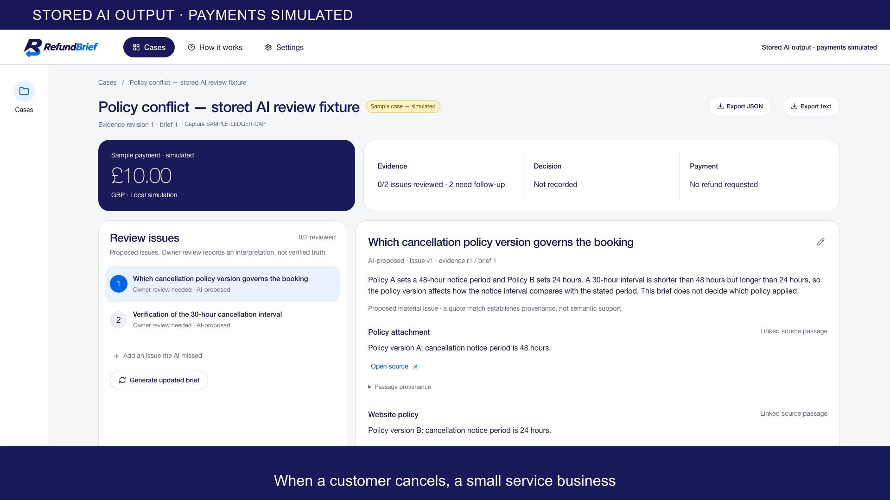
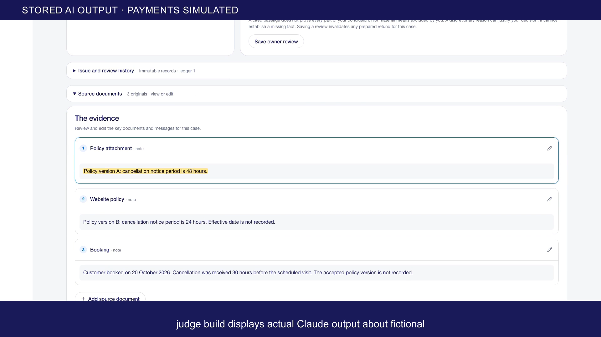
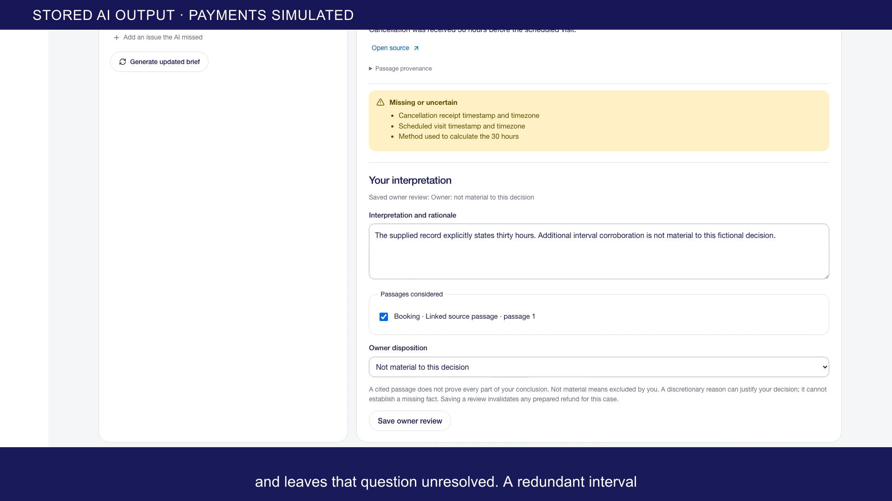
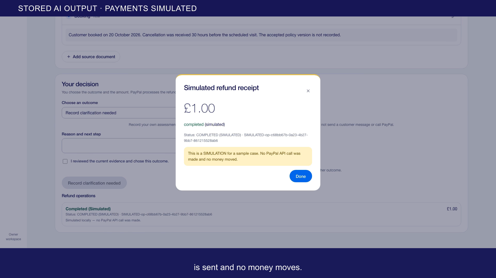
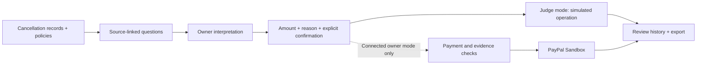

<p align="center">
  
</p>

<p align="center">
  <strong>Cancellation evidence review for small service businesses.</strong><br>
  Source-linked AI questions. Your interpretation. An explicitly approved action.
</p>

<p align="center">
  <a href="https://youtu.be/VkDG0VLhEQ4"><strong>Watch the 2:05 demo</strong></a> &nbsp;·&nbsp;
  <a href="https://devpost.com/software/refundbrief">View the Devpost entry</a> &nbsp;·&nbsp;
  <a href="#judge-testing">Run the judge build</a> &nbsp;·&nbsp;
  <a href="https://github.com/rumi7911/RefundBrief/releases/tag/v1.0.1-judge">Download v1.0.1</a>
</p>

<p align="center">
  
  
  <a href="LICENSE"></a>
</p>

<p align="center">
  
</p>

## A clearer decision before a refund

A cancellation message, booking record and two policy versions can tell different stories. RefundBrief helps an owner inspect those sources before choosing what to do. Missing accepted terms stay missing; the useful next step may be clarification.

AI organises cited passages and proposes questions. **A matching quotation proves where text came from, not which policy applies or whether money is owed.** The owner records an interpretation, chooses any amount and explicitly approves the action. The model has no payment tools.

> **Judge-build mode:** stored Claude output about fictional sources and **simulated payments**. No fresh model request, PayPal call, funded account or provider credential is needed at runtime. This is a downloadable local build, not a hosted application.

## See the review workflow

<table>
  <tr>
    <td width="50%">
      <a href="docs/assets/screenshots/01-workspace.png"></a>
      <br><strong>1. Find the question</strong><br>Conflicting policies and missing accepted terms stay visible.
    </td>
    <td width="50%">
      <a href="docs/assets/screenshots/02-sources.png"></a>
      <br><strong>2. Inspect the source</strong><br>Open the attributed passage and consider the complete record.
    </td>
  </tr>
  <tr>
    <td width="50%">
      <a href="docs/assets/screenshots/03-owner-review.png"></a>
      <br><strong>3. Record your judgement</strong><br>Keep uncertainty, cite a conclusion or explain an exclusion.
    </td>
    <td width="50%">
      <a href="docs/assets/screenshots/04-simulated-receipt.png"></a>
      <br><strong>4. Confirm an action</strong><br>Choose the amount, review, confirm and inspect the simulated receipt.
    </td>
  </tr>
</table>

These are unchanged stills from the functioning fictional desktop demonstration, with its simulation labels and film captions. [Asset provenance](docs/assets/README.md). They are not fresh AI or live payment evidence.

## Judge testing

Use the **[verified v1.0.1-judge release](https://github.com/rumi7911/RefundBrief/releases/tag/v1.0.1-judge)**. Download and extract its source archive, then open a terminal in the directory containing `package.json`.

**Requirements:** Node.js **22.13+ (22.x) or 24+**, npm and a browser. No Docker, database service, local model or funded provider account.

```sh
npm ci
npm test
npm run build
npm run demo
```

Open **http://127.0.0.1:4184/**. The **Policy conflict — stored AI review fixture** opens automatically. `npm ci` needs internet access to download locked packages; the running demo does not contact AI, payment or account providers. Node's experimental SQLite warning is expected.

Try this short route:

1. Open the 48-hour and 24-hour cited passages. Notice that the accepted policy version is missing.
2. Save your own interpretation for both issues. Leave the governing-policy question unresolved; explain whether the redundant interval question is material.
3. Choose a fictional outcome. For a refund simulation, enter `1.00` and a reason, review the details, then explicitly confirm.
4. Inspect the labelled receipt and export. Edit a source to see the previous brief become stale.
5. Stop with **Ctrl+C** and run `npm run demo` again for a fresh fictional workspace.

The amount starts blank. A chosen citation does not prove every part of a conclusion. Each launch uses a new OS temporary workspace, preserving the owner's private data and historical operations. Generation controls and external-account routes are intentionally disabled. If the port is busy, stop only your own earlier demo process.

[Complete judge runbook and payment-state meanings →](docs/judge-runbook.md)

## How it works



| Part | Role |
| --- | --- |
| React · TypeScript · Vite | Source inspection, owner interpretations and explicit action review. |
| Express · Node SQLite | Versioned sources/reviews, decision bases and operation history. |
| Anthropic Claude | Original cited AI questions; the judge route reuses stored fictional output. |
| PayPal Sandbox | OAuth, capture/order inspection, refund submission and separate refund lookup in connected owner mode. |

Source documents are untrusted data. Approval binds the current evidence, brief and owner-review versions. The server checks ownership, GBP balance and the evidence basis before dispatch, stores stable operation keys and holds pending/unknown outcomes for reconciliation. Refund lookup identity must match before state can change. One refund per capture is supported. [Technical details and connected setup](docs/technical-notes.md).

## What is verified

**Recorded on 6 November 2026 for the exact v1.0.1 judge archive:** 193 tests in 24 files, production build, clean-archive installation and the full fictional walkthrough passed. The exercised demo routes made zero external provider requests. This is dated local verification, not a live CI badge.

Separate saved records from **4 November 2026** document an agent-controlled PayPal Sandbox test: a **GBP 10 capture**, an explicitly approved **GBP 1 refund**, and a matching separate refund lookup. An earlier pre-send refusal remains unexplained. These historical API tests are separate from the simulated demonstration.

[Verification summary and limits →](docs/public-verification.md)

## Scope and limits

- Single-owner, loopback-only prototype; GBP sandbox use, not production payments.
- Schema and exact-quote checks do not establish semantic correctness, entitlement or complete coverage.
- The current neutral prompt has not had a new full remote evaluation. Live optional ChatGPT consent/inference remains unverified.
- Human interpretation quality, representative usability benefit and time savings remain unmeasured.
- Bounded browser, regression and accessibility checks are not a security audit, production sign-off or whole-app accessibility certification.

## Find your way around

| Path | Purpose |
| --- | --- |
| [`src/`](src/) | Review workspace and owner-facing React interface. |
| [`server/`](server/) | Provider adapters, source/review contracts, payment safeguards and regression tests. |
| [`fixtures/judge-policy-conflict/`](fixtures/judge-policy-conflict/) | Original fictional source packet/output and separately transformed neutral fixture. |
| [`docs/judge-runbook.md`](docs/judge-runbook.md) | Complete credential-free judging route. |
| [`docs/technical-notes.md`](docs/technical-notes.md) | Existing review contract, connected mode and implementation details. |
| [`docs/public-verification.md`](docs/public-verification.md) | Dated evidence and explicit unverified claims. |

## Contribute and report issues

Focused improvements to review clarity, safeguards, accessibility and reproducibility are welcome. Read [CONTRIBUTING.md](CONTRIBUTING.md) before changing the workflow. Use [SECURITY.md](SECURITY.md) for security-reporting boundaries; do not put credentials or private case records in an issue.

## Release integrity and licence

The **v1.0.1-judge tag, source archive and checksum remain the tested submission build**. This branch's README and presentation assets were refreshed afterwards; `SOURCE-MANIFEST.json` records the frozen release's source hashes, not a new build of this presentation revision. No product code, dependency, schema or payment-history change is part of this refresh.

[MIT licence](LICENSE). Third-party dependencies retain their own licences. The approved logo, real demo stills and header-art provenance are recorded in [docs/assets/README.md](docs/assets/README.md).
